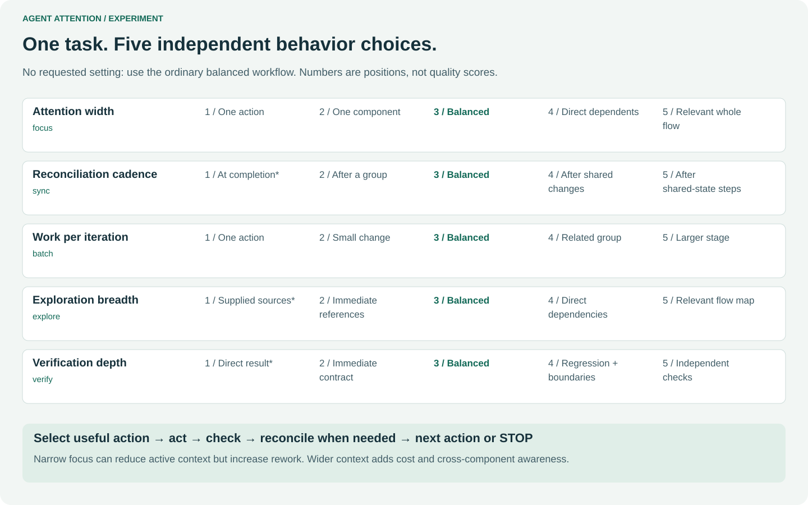
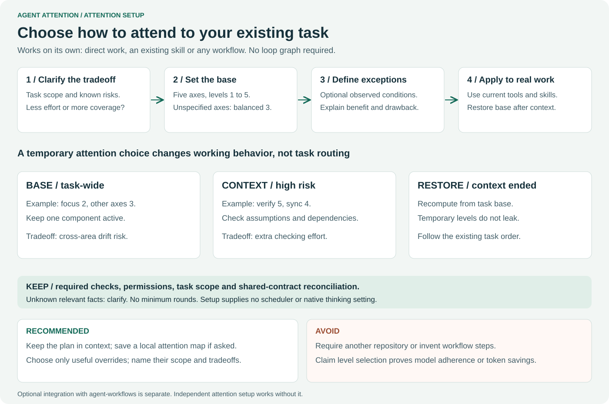

# Agent Attention

An independent attention layer for AI agents: **five axes, five levels each,
balanced by default**. Choose a task profile once and carry it across direct work,
Loop or other skills. No downstream skill modification is required.

Optional **attention setup** asks about the five-axis base profile, conditional
temporary levels, tradeoffs and restoration. It works on the task you already
have. No workflow graph, Loop skill or second repository is required.

Version: **0.2.1**. This is behavioral guidance, not a model
reasoning-effort setting or an enforced scheduler. Token savings are unmeasured.



## Start

Install the self-contained `skills/agent-attention` folder in your host's supported
skill directory. For a Codex project, for example, copy that folder to
`.agents/skills/agent-attention`; preserve any existing local customization.
Open a fresh session and verify actual host discovery. Do not replace the host's
skills directory or install the entire source repo as one skill.

On a host supporting explicit skill mentions:

```text
Use $agent-attention with focus=2,sync=4 for this task.
Keep the profile while implementing, testing and reviewing.
```

Read-only configuration preview from this repository:

```text
python scripts/attention.py --attention "focus=2,sync=4" --workflow direct
python scripts/attention.py --attention balanced --workflow loop-code
```

The workflow label does not invoke anything. All unspecified axes remain 3.
No attention request means ordinary host/workflow behavior.

New in this version: preview controlled **single-axis comparisons** without
calling a model, then execute the selected design and summarize quality/token
results separately. See [axis campaigns](docs/testing/AXIS-CAMPAIGNS.md).

```text
python scripts/evaluate_effort.py --axis focus --levels 1 2 3 4 5 --repeats 2 --plan
```

Apply the profile directly to the next read, change and check. Activation requires
no helper calls, state files or transition summaries. Optional persistence is a
separate explicit request, not the mechanism that makes the mode work.

## Optional attention setup

Ask **`$agent-attention setup`** to design an attention plan. The agent asks about
scope, base levels, optional conditions, benefits/drawbacks and when to restore
the base. Keep it in context or explicitly request a private attention map.
This configures attention; it does not invent task steps, routes or cycles.



[Attention setup guide](docs/ATTENTION-SETUP.md) ·
[Optional integration with an existing workflow](docs/WORKFLOW-SETUP.md)

## What changes

| Axis | Controls | Balanced |
|---|---|---|
| focus | active attention width | existing task scope |
| sync | reconciliation cadence | important task boundaries |
| batch | decomposition and intermediate inspection depth | complete bounded item |
| explore | discovery breadth | expand for concrete unknowns |
| verify | additional checking depth | existing risk-based checks |

Permissions, mandatory checks and correctness requirements remain. Shared-contract
changes always trigger reconciliation before dependent work. More is not always
better: broad context adds cost; narrow context can increase rework.

All axes now follow the same effort direction: 1–2 reduce discretionary work,
3 is balanced, 4–5 increase it. Token use is expected to follow that direction,
but retries, required checks and cache effects can change total usage.
**0.1.0 migration:** `batch` previously meant batch size; in 0.1.1 it means
decomposition depth. Re-select non-default batch levels instead of reusing old
profiles unchanged. Older checkpoint files do not identify the semantic revision.

[Full guide, level illustrations and tradeoffs](docs/GUIDE.md) ·
[Offline configuration preview](docs/attention-playground.html) ·
[Evidence and limitations](docs/testing/RESULTS.md)

## Develop

Python 3.11+, standard library only:

```text
python -m unittest discover -s tests -v
python scripts/attention_assets.py
```

After changing generator sources, run `python scripts/attention_assets.py --write`.
Generated outputs are checked in tests and CI.

## Origin

Extracted from the attention prototype in
[agent-workflows](https://github.com/Clas4444/agent-workflows), based on prototype
commit `e2b1b717b1e751a9218fa6ad22381c6fd7f55cbb` retained locally after deleting
the remote experiment branch. This repo has separate history and checks. It does
not include the 53 Loop skills or inherit their historical runtime PASS claims.

MIT license; original copyright retained.

## Documentation

[Documentation map](docs/README.md) · [Changelog](CHANGELOG.md) · [Release and compatibility](docs/RELEASE.md)
