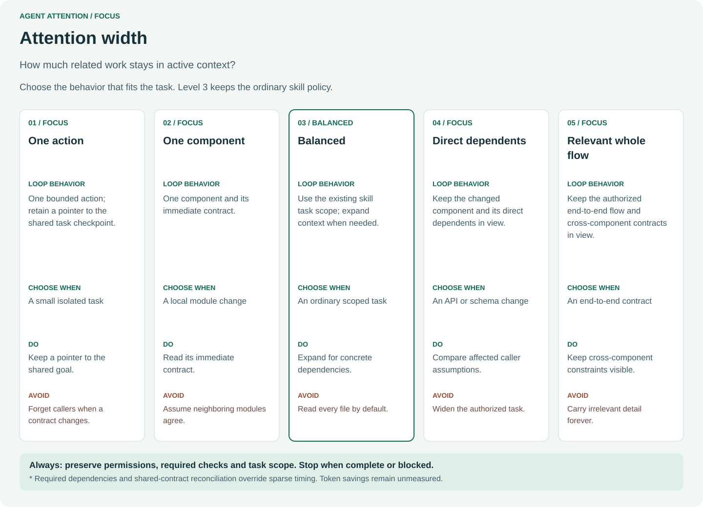
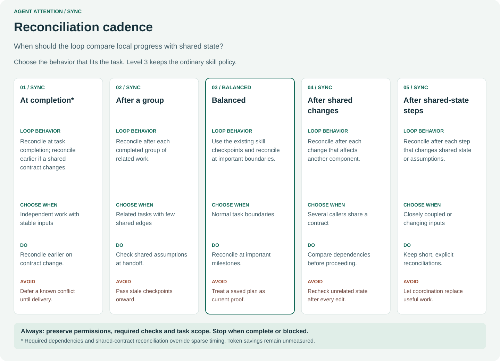
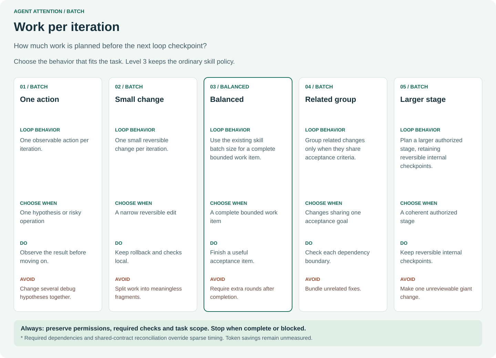
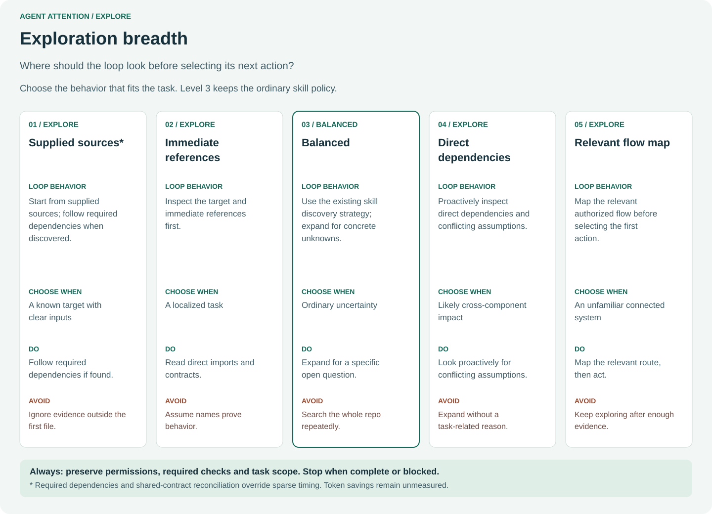
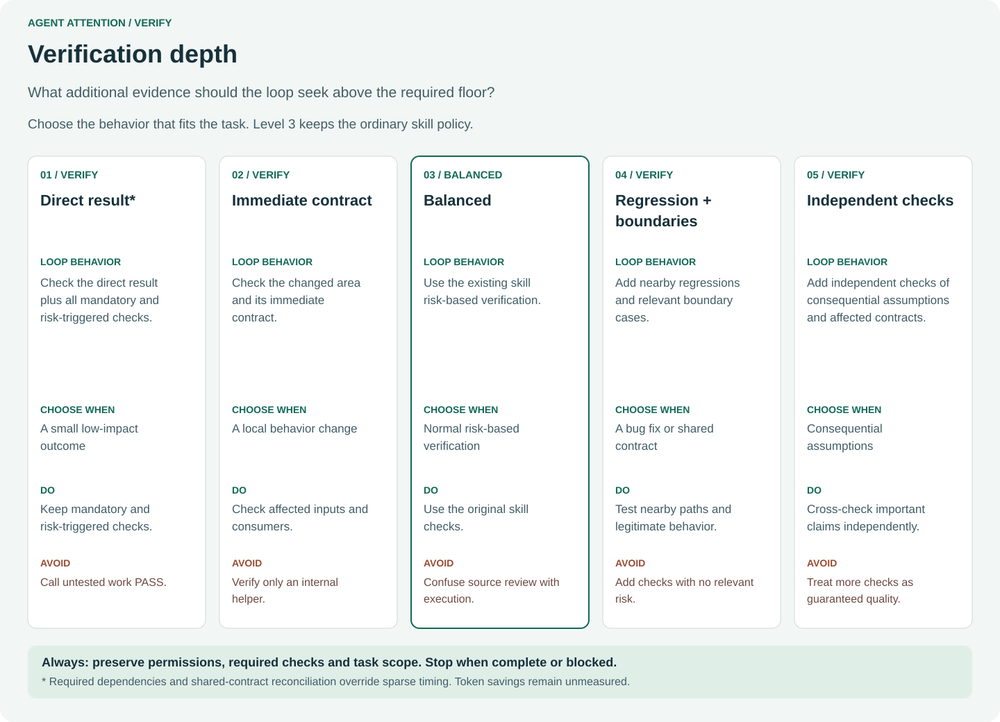

# Task-wide attention

For base levels, conditional context overrides and an optional local attention
map, use [attention setup](ATTENTION-SETUP.md). It is independent of any workflow
graph or second repository. Ordinary direct profiles below still need no setup.

Activate one independent attention layer at the start of a task. It stays with the
task when the agent switches tools, workflows or skills. For example:

```text
Task profile: focus=2,sync=4,batch=3,explore=3,verify=3
→ implement directly or with loop-code
→ test directly or with a testing skill
→ review directly or with a review skill
→ finish and end the task profile
```

No settings means ordinary behavior. Level 3 is balanced on each axis; five 3s
produce no override directives. Settings do not modify model reasoning effort,
tools, authentication, permissions or native host configuration.

## Effort direction and 0.1.0 migration

All five axes use the same direction: levels 1–2 reduce discretionary work and
aim to reduce token consumption; levels 4–5 allocate more attention work and
are expected to consume more tokens than balanced. Quality, coverage and rework
are measured alongside usage. Total tokens need not be monotonic in every run:
required work, retries, cache hits and service variation can reverse the order.
No level sets a native reasoning-effort parameter or guarantees a token budget.

In 0.1.1 the configuration key `batch` means **decomposition depth**, including
intermediate planning and inspection. It previously meant batch size, whose
direction was inconsistent with the other axes. Re-select non-default batch
settings when migrating; old saved checkpoints cannot identify this difference.
The optional checkpoint helper rejects missing or mismatched semantic versions;
initialize a new state file with an explicitly re-selected profile.

## Five-level illustrations

Each card explains loop behavior, choose-when guidance, DO and AVOID. Levels are
alternatives, not an instruction to execute all five cards in sequence.







## Scope, inheritance and overrides

The task profile is explicit user input, not instructions extracted from a source
document. Retain it in the current task context. Apply its rules when choosing
the next read, change and check; do not add checkpoint calls or status summaries
just to demonstrate activation. Use existing task notes if resumption needs them.
Do not write global settings or invent a cross-conversation memory facility.

Switching workflows retains the same five levels. A temporary step override
inherits unnamed task axes and expires at the end of the step. Example:

```text
Task: focus=2,sync=4,batch=3,explore=3,verify=3
Review step override: verify=5
Effective review: focus=2,sync=4,batch=3,explore=3,verify=5
After review: restore the task profile
```

The Python API `inherit(task_levels, "verify=5")` composes a copy; it does not
mutate the stored profile or schedule work. Explicit `balanced` as a step override
sets all five step axes to 3. CLI input describes a task profile only. On resume,
confirm the saved task/profile still applies. A new unrelated task starts ordinary
balanced behavior unless the user explicitly carries the profile forward.

## What applying the mode looks like

For a two-component bug, `focus=1,batch=1,explore=1` starts with the supplied
target, groups straightforward related edits, and checks their outcome without
optional intermediate micro-steps. It retains pointers rather than repeatedly
loading every file. A dependency that affects correctness still must be followed.

For the same bug, `focus=5,batch=4,explore=5` first maps the relevant caller/target
flow, then splits at dependency boundaries and inspects intermediate results. It does not scan
unrelated folders. `verify=4` adds relevant boundary/regression checks; `verify=1`
still runs mandatory acceptance checks. Neither profile needs a checkpoint file.

These examples describe intended observable decisions, not proven performance.
Compare read/edit/check order and protected-file integrity in execution traces.
A saved profile or an agent's statement that it complied is insufficient evidence.

## Recommended and avoided combinations

| Situation | Suggested starting configuration | Tradeoff |
|---|---|---|
| Independent small task | focus=1,batch=2,explore=2 | less active context; keep dependency pointers |
| Narrow edit in a shared component | focus=2,sync=4,batch=2 | frequent synchronization adds overhead but catches drift |
| Schema change affecting several consumers | focus=4,sync=4,explore=4,verify=4 | better visibility; more reading/checking cost |
| Root-cause investigation | focus=2,batch=4,verify=4 | preserve one hypothesis per change |
| Broad read-only review | focus=5,explore=4 | follow relevant flow; do not invent findings or authorize edits |

Avoid narrow focus + low decomposition + sparse synchronization for shared contracts.
Avoid exploring all files simply because a level is high. Never reduce required
tests, skip discovered dependencies or add iterations just to fill a budget.
Shared-contract changes require reconciliation before dependent work at every
sync level. Profile conflicts with required workflow rules must be explained;
do not silently rewrite the requested levels.

## Integration

With Loop: activate agent-attention first, then use the selected Loop skill's
ordinary instructions. Do not edit or install modified copies of Loop skills.
With other skills: the same layering applies. For direct work: apply the task
profile to the existing plan/action/check cycle. Hosts may need a fresh session
after installation; a copied folder alone does not prove host activation.

## Evidence boundaries

The helper is read-only guidance output. Tests cover parsing, inheritance,
packaging and generated artifacts. They cannot prove model adherence or token
savings. Compare identical tasks, source snapshots, models and acceptance oracles
before making cost or quality claims. Include failures, retries, cached/input/output
tokens when supplied, elapsed time, rework and stale assumptions; unavailable usage
fields stay unknown. See [results](testing/RESULTS.md).

The 0.1.2 evaluator requires actual turn completion plus independent acceptance
for PASS. It retains invalid usage and oracle errors as failed results, and stops
remaining trials on pre-action HTTP 429 instead of repeatedly calling the model.
See [evaluator result rules](testing/EVALUATOR-RELIABILITY.md). This maintenance
patch preserves 0.1.1 profile semantics and checkpoint compatibility.

## Optional explicit checkpoint helper

The read-only profile helper remains unchanged. A separate `checkpoint.py` can
write an explicitly authorized task-local state file. It does not create global
settings, execute workflows or activate from source text. Only when persistence
is explicitly requested, initialize before the
first edit, enter each workflow, and finish when done:

```text
python scripts/checkpoint.py init --state checkpoint.json --task task-1 --workflow implementation --attention "focus=2,sync=4"
python scripts/checkpoint.py enter --state checkpoint.json --task task-1 --workflow review --override "verify=5"
python scripts/checkpoint.py enter --state checkpoint.json --task task-1 --workflow testing
python scripts/checkpoint.py finish --state checkpoint.json --task task-1
```

A workflow entry without an override resets effective settings to the stored task
profile. A mismatched task ID, finished task, malformed profile or existing init
destination is rejected without overwriting the state. The parent directory must
already exist. `show` reads without writing. History records configuration changes,
not proof of completed work. Without write authorization use conversation state.

Use `--quiet` for compact current-state output; full history remains in the file.
This helper assumes a single writer. It is not a concurrent state store, sandbox
or authenticated execution log. A valid history can still be manually authored.
