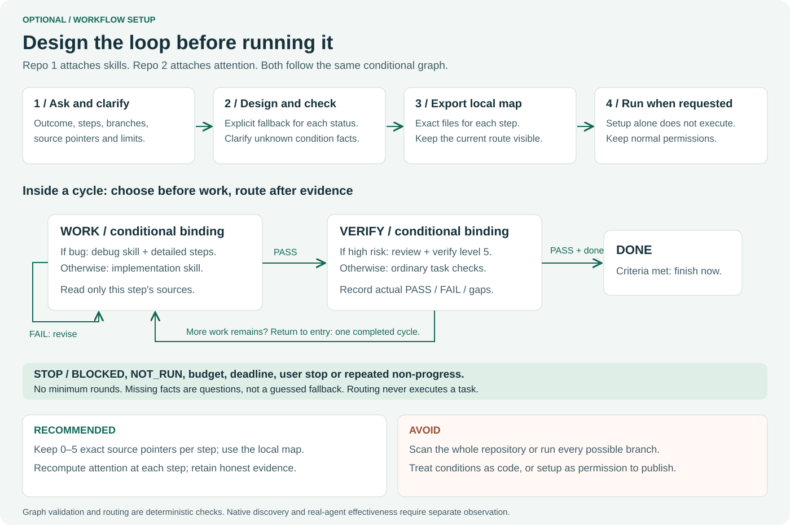

# Optional attention workflow setup

Use `$agent-attention setup` to design per-step attention choices, or attach them
to a workflow from [Repo 1](https://github.com/Clas4444/agent-workflows). A direct
task-wide profile still works without any setup or graph. Natural-language
"agent-attention setup" expresses the intent; native slash/picker syntax depends
on the host. This repo does not add a `/workflow` alias.



## Interview and conditional modes

The agent asks two or three related questions at a time and reuses known answers.
It gathers the outcome, step list, criteria, exact source pointers, condition
facts and their provenance, profiles for each branch, result routes, cycle end,
limits and project/output location. Missing facts are clarified rather than
treated as false. Show ordered branch priorities; fallback is explicit and last.

For example, the same verify step can select verify=5 when risk=high, and ordinary
verify=3 otherwise. The work step can use focus=2,batch=4 for a bug and focus=3
otherwise. Task settings are inherited by every branch; unnamed axes stay at
their task levels. A branch override expires when that step ends. The next
selection recomputes effective levels instead of carrying the previous override.

Profiles affect work choices described in the attention guide; they do not set
native model effort, permissions or a token budget. Higher levels allocate more
discretionary attention, without guaranteed per-run token ordering.

## Attach to an existing Repo 1 graph

Use the shared schema_version=1 graph. It has steps, ordered pre-work bindings,
post-observation transitions, exact sources, criteria, condition fact names,
provenance and bounded cycle/step limits. A closing cycle_end route explicitly
returns to entry. DONE finishes immediately; STOP ends or pauses the workflow.

The attachment helper changes attention fields only. Example modes.json:

```json
{"attention":{"sync":4},"steps":{"verify":[{"binding":0,"attention":{"verify":5}},{"binding":1,"attention":{"verify":3}}]}}
```

```text
python scripts/workflow_setup.py attach --file workflow.json --patch modes.json
```

The returned document preserves skill names, when conditions and transitions,
and leaves the input file unchanged. Indexes are zero-based in the displayed
binding list. Unknown/duplicate indexes and route-editing fields are rejected.
Review and save the result as a new draft, then validate/export. To add conditions
that do not exist in the graph, explicitly revise the ordered graph in the setup
interview; attach does not invent branches. The two repos need no runtime import
of one another and remain independently installable.

## Design without Repo 1

```text
python scripts/workflow_setup.py questions --layer attention
python scripts/workflow_setup.py template --layer attention
python scripts/workflow_setup.py check --file draft.json
python scripts/workflow_setup.py export --file draft.json --project C:/MyProject
```

The example template is not a completed interview. Replace it with the user's
answers and a real task. No skills need to be named in an attention-only graph.
The `both` template is available for an explicitly combined design. Helpers are
bundled under the installed skill's scripts/; source-repo paths above are examples.
No Python? Draft with existing tools and mark helper validation NOT_RUN.

Export creates a NEW local .loop/workflows/&lt;id&gt; directory with workflow.json,
AGENT-MAP.md, diagram.mmd and a local .gitignore ignoring all its contents.
Existing designs and project-wide ignore settings are preserved. --output can
select another normalized project-relative directory; output aliases are blocked.
An I/O failure may leave a partial new folder, so inspect it before retrying.
Force-add can still publish ignored files: sanitize only deliberately shared
copies, and keep the machine-local map local.

## Follow the current route

The map names the project root, 0–5 exact sources per step, candidate installed
instruction paths, acceptance criteria, branch facts and their provenance. Load
only the current step and selected binding; do not scan every file or skill.

```text
python scripts/workflow_setup.py start --file workflow.json --facts-file facts.json
python scripts/workflow_setup.py select --file workflow.json --state cursor.json
python scripts/workflow_setup.py advance --file workflow.json --state cursor.json --status PASS --evidence "required checks passed" --facts-file observed-facts.json
```

start/advance print state; retain it in existing context or an explicitly chosen
local cursor file. They do not write that file or execute work. The agent actually
does and checks the authorized step, then reports PASS/FAIL/BLOCKED/NOT_RUN with
real evidence. The helper routes a supplied observation; it cannot judge task
success or authenticate a manually edited cursor.

Returning from cycle_end to entry counts one cycle. Maximum cycles/steps return
STOP; DONE ends immediately. Also stop on user request, deadline, safety boundary
or repeated non-progress. The helper does not observe those host conditions by
itself. Changed graph hashes reject old cursors; review the design and restart
explicitly. Required checks and external-action boundaries always remain.

Missing condition facts print JSON BLOCKED and exit 2 without changing state.
Invalid configuration exits 1; exit 0 means a helper operation succeeded, not
that every routed step or stopped business task passed.

## Compatibility and evidence

Release 0.2.0 retains axis semantics version 0.1.1. Existing task-profile checkpoint
files remain compatible; workflow cursors are a separate graph-bound format and
are not interchangeable with checkpoint.py state. Ordinary profile use still
requires no graph or cursor. Setup does not alter installed downstream skills.

Graph/attachment/private-export/installed-Python checks are deterministic tests,
not new model attempts or native-discovery proof. Existing 0.1.1 model measurements
retain their old pins. New real-agent interview/loop effectiveness and remote CI
are NOT_RUN for this local candidate. See [setup checks](testing/WORKFLOW-SETUP.md).
