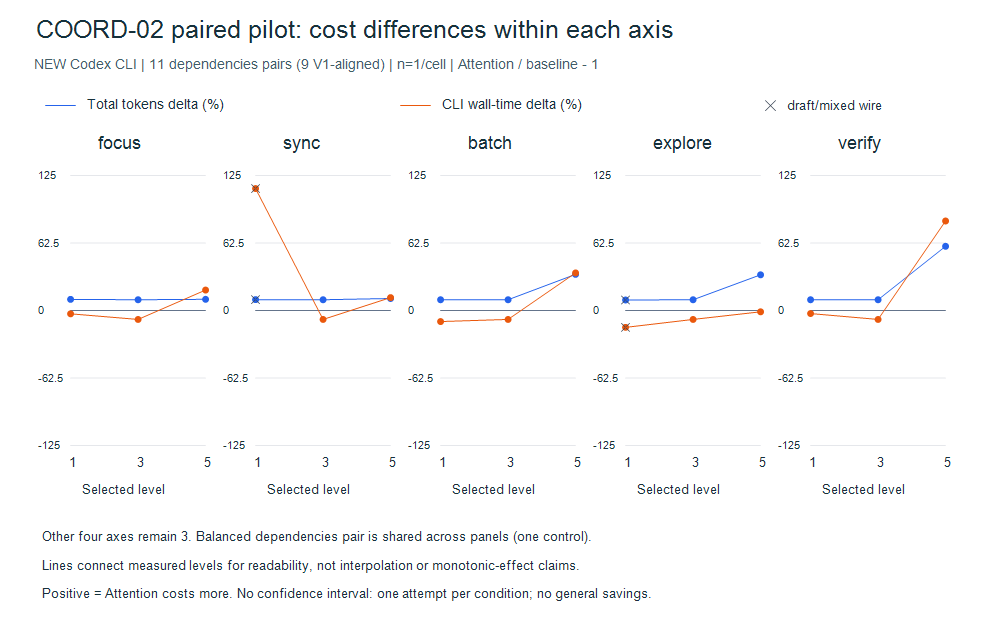
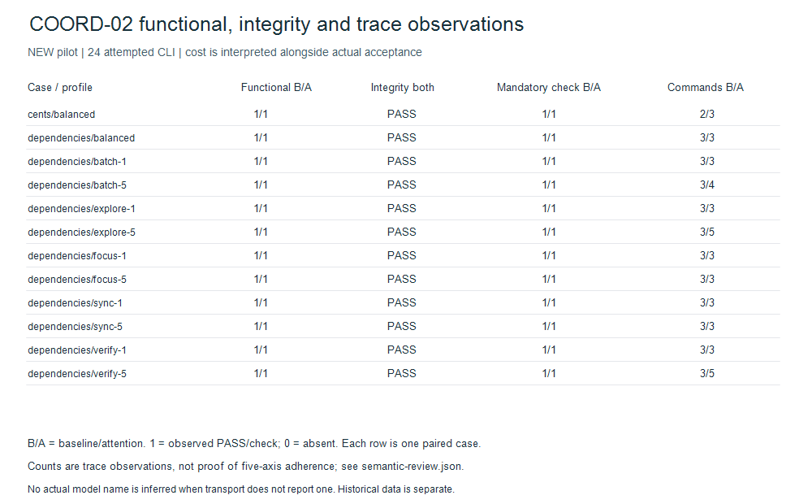

# COORD-02 — published paired Codex observations

Sanitized publication from the completed local review package. Base SHA `0698c709243a77d40b6f7affb4b2a5ec1dfc184c`; no version bump.

## New model sessions, separated from tests and history

**24 experimental Codex CLI invocations, 24 completed model turns, 24 frozen
functional PASS, 24 protected/candidate-file integrity PASS.** All 24 actually
execute a successful mandatory `checks.py` command in the trace. No missing
usage, failed attempt, retry, timeout or quota/capacity/auth stop occurred.
The SQLite task budget is exactly24 reserved, zero in flight, zero remaining.
Helper/oracle processes, debug/login preflight and synthetic test CLIs are
different units and are not counted as these 24 model sessions.

The CLI transport does not report an actual model name in any of the24 traces.
Requested model is the configured host default with no model/effort override;
actual model is null/NOT_REPORTED, never inferred from the parent chat. Internal
model-request counts are not reported and are not equated to CLI invocations.

The initial three attempts used an incompatible draft marker wire format.
They remain in [observations](observations.json) as DRAFT_MISMATCH, while all
functional/file-integrity labels remain original. A local schema pause allowed
the already in-flight call to finish. The continuation uses the exact unexecuted
suffix of the original seed/order, same prompts/skill/fixtures and the same
persistent cap24 ledger; changing the campaign ID does not reset the budget.

Consequently there are **12 descriptive complete pairs** (11 dependencies,
one balanced cents), but only **10 complete pairs with both arms on the common
v1 wire** (nine dependencies and the cents holdout). The explore=1 pair uses the
initial draft and the sync=1 pair straddles the alignment. Their points are marked
with x on the figure. This distinction is not hidden or upgraded to a clean
causal experiment. No provider-level fault occurred during either phase.

## Paired effects: n=1 per cell



Figure 1. Relative total-token and CLI wall-time deltas in percent; n=1 per
paired condition. Legend distinguishes cost/time and x marks draft/mixed wire
pairs. [Download SVG](axis-paired-effects.svg) · [Source CSV](paired-effects.csv) ·
[Observations JSON](observations.json) · [Figure primitives](chart-data.json) ·
[Reproduction script](../../../../../scripts/coord02_report.py).

The four non-selected axes remain3. The same single balanced dependencies pair
appears at level3 in each panel; those are not five independent controls. Lines
connect measured points for readability, not interpolation. Total token delta
is `(attention input+output)/(baseline input+output)-1`; cache and reasoning
subsets are never added twice. Time is CLI wall seconds, not API duration or
billable request cost. Raw precision/source values are in [paired-effects.csv](paired-effects.csv).

| Dependencies profile | Paired total-token delta | Paired wall-time delta |
|---|---:|---:|
| balanced | +10.11% | -8.16% |
| focus=1 | +10.46% | -2.92% |
| focus=5 | +10.47% | +19.06% |
| sync=1 (draft/mixed) | +10.19% | +113.07% |
| sync=5 | +11.27% | +12.06% |
| batch=1 | +10.10% | -10.09% |
| batch=5 | +33.60% | +34.92% |
| explore=1 (draft) | +9.86% | -15.46% |
| explore=5 | +33.17% | -1.06% |
| verify=1 | +10.11% | -2.66% |
| verify=5 | +59.59% | +83.02% |

Balanced cents is a separate holdout: +9.74% tokens, +25.89% wall time, both
arms functionally correct. No quality separation occurs on the frozen checks.
The sync=1 wall-time outlier shows why neither time nor tokens should be assumed
monotonic. These cells are one attempt each: no confidence interval, reliable
axis ranking, global Codex average or causal savings conclusion is justified.
Host latency, shared authentication/cache, local checks and possible concurrent
activity can affect time. Actual-model identity remains unverified.

## Behavior and quality, beyond cost



Figure 2. Acceptance and mandatory-command evidence alongside terminal-command
counts for 24 CLI attempts. Each row is a baseline/attention pair; 1/1 means both
arms passed the check. This is not evidence that all five axes have a proven benefit. Focus breadth is
unidentified; verify adds checks in one case without improving saturated quality.
[Download SVG](quality-behavior.svg) · [Source JSON](observations.json).

[semantic-review.json](semantic-review.json) retains heuristic observations and
separate manual interpretations, keyed to original trace SHA-256. The audited
mandatory-check flag requires an actual successful Python invocation; a read,
echo or model self-report mentioning `checks.py` does not pass it. The original
adapter's permissive filename proxy remains in the original observation fields;
the corrected derived audit is additive, not an overwritten historical result.

Actual examples:

- `batch=5`, trial04-attention: edits closure, reads graph.py, then inspects and
  edits dependent planner.py; intermediate inspection is in tool commands.
- `sync=5`, trial06-attention: reads graph.py, planner.py and FLOW.md between
  dependent edits. This supports one observed reconciliation read, not a measured
  frequency effect for all shared-contract transitions.
- `explore=5`, trial08-attention: additional project/reference search before
  editing. The small required flow was already covered by mandatory supplied
  evidence; extra discovery gives no observed quality improvement here.
- `verify=5`, trial07-attention: after mandatory checks, runs an independent
  exhaustive oracle over512 directed three-node graphs ×8 request subsets,
  duplicate edges and input preservation, plus a5000-node chain. The command
  exits0. This expands checking coverage at extra effort; it does not improve
  the already saturated correctness score in this sample.
- `focus=1/5`: both inspect the small required flow; no independent breadth
  contrast is identified. This does not prove focus ineffective in larger tasks.

No state-write proxy is used. Model context restoration across live steps and
native combined Workflow+Attention execution are NOT_RUN in this axis pilot.
Separate helper tests prove non-mutating selection/restoration after exceptions,
versioned opt-in field preservation, portable maps and no fixture cross-write;
they are not model adherence evidence or an OS security attestation.

## Auth/context isolation and coordination

Copilot is not invoked in COORD-02. Its old auth-home/startup attempts and shared
markers are unchanged. For Codex, the supported host login cache stays in place;
no credential/token is read to output or copied into fixtures. Official
[authentication documentation](https://learn.chatgpt.com/docs/auth) describes
host cached login and credential storage. Local CLI `exec --help` separately
states that ignore-user-config retains host authentication; this adapter instead
keeps the same normal config for debug/exec parity and applies per-command
discovery exclusions, with no model/effort override.

Auth preflight passes via `codex login status`. Actual debug inventory has0
skills for neutral baseline,1 exact project candidate for attention, no parent
AGENTS context;177 host skill paths are excluded. Plugins/apps/memory/multi-agent
are off and exec sessions are ephemeral. This is model-visible context
preflight isolation, **not full-home/OS isolation or a runtime-prompt attestation**.
Provider is `codex`, account/quota domain is unknown. Same-provider global faults
pause until domain review; another provider is not locked. No provider/account
switching or old-grid resume occurs.

The two frozen protocols, [initial](protocol-initial.json) and
[continuation](protocol-continuation.json), retain source pins, order, rubric,
expected signatures and limitations. Private source snapshots match those pins.
Post-pilot changes correct trace instrumentation, marker diagnostics and PASS gating;
current source hashes must not be substituted for measured source pins.

## Reproduce locally and inspect limitations

```text
python -m scripts.coord02_report --directory docs/testing/reports/2026-11-03/coord-02 --png
python -m unittest discover -s tests -v
python scripts/attention_assets.py
git diff --check
```

SVG/CSV/summary use only sanitized observations; PNG additionally uses Windows
PowerShell7/System.Drawing. Both actual PNGs were rendered and viewed. The
publication hash list pins packet bytes and separately records current source hashes.
[Historical receipt audit](historical-receipt-audit.json) verifies old report
artifacts unchanged and labels changed old source receipts STALE. It never
rewrites old hashes to disguise new work as an old verified release.

The previous [historical66 lines](../historical-lines.svg)
remain separate with their source table and confounding/focus1 limitations.
They are not pooled into the new paired effects. For decisions, balanced remains
the default; target the axis relevant to observed risk, retain mandatory checks,
and do not raise all levels or manufacture extra rounds to force an ordering.

## Published evidence and frozen source reproduction

Original observation/protocol bytes (including their then-current NO_PUSH flag)
are retained. That flag records the experiment stage; it does not describe current
delivery authorization. Current source receipts become STALE when code changes;
measured source archives retain original pins. Published command excerpts omit
agent messages, session/account IDs and machine paths; original raw-trace hashes
identify provenance but do not permit byte-for-byte raw trace replay. No raw trace
is publicly available. Command redactions are listed in trace-evidence.json.

See [source archives](snapshot-index.json), [trace evidence](trace-evidence.json),
[budget receipt](budget-receipt.json) and [publication hashes](sha256.json).
Source archives contain only frozen repository source, fixtures and skill files;
no credentials, private config, local maps or experiment workspaces. They let a
reviewer inspect measured implementations and run deterministic controls, not
repeat model outcomes. Reports/figures reproduce offline from observations:

```text
python -m scripts.coord02_report --directory docs/testing/reports/2026-11-03/coord-02
python -m scripts.evaluation.delivery --directory docs/testing/reports/2026-11-03/coord-02
```

The final review corrected a remaining status gate: missing mandatory-command
evidence or a transport/accounting stop cannot earn PASS even if an artifact
passes its oracle. Synthetic negatives reproduce the old acceptance flaw; this
post-campaign fix does not relabel original observations. All measured attempts
had valid usage and successful mandatory commands. No new model calls followed.

Final delivery checks and current historical receipt invalidation are recorded in
[final gates](final-gates.json). Earlier gate counts remain historical snapshots.
