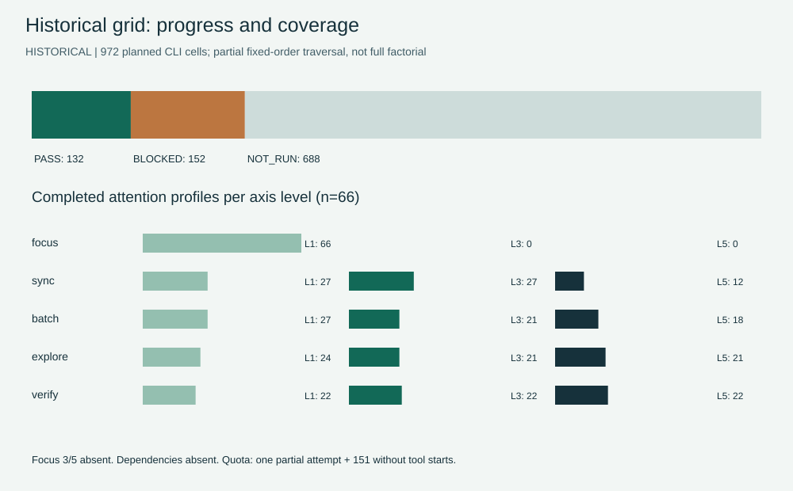
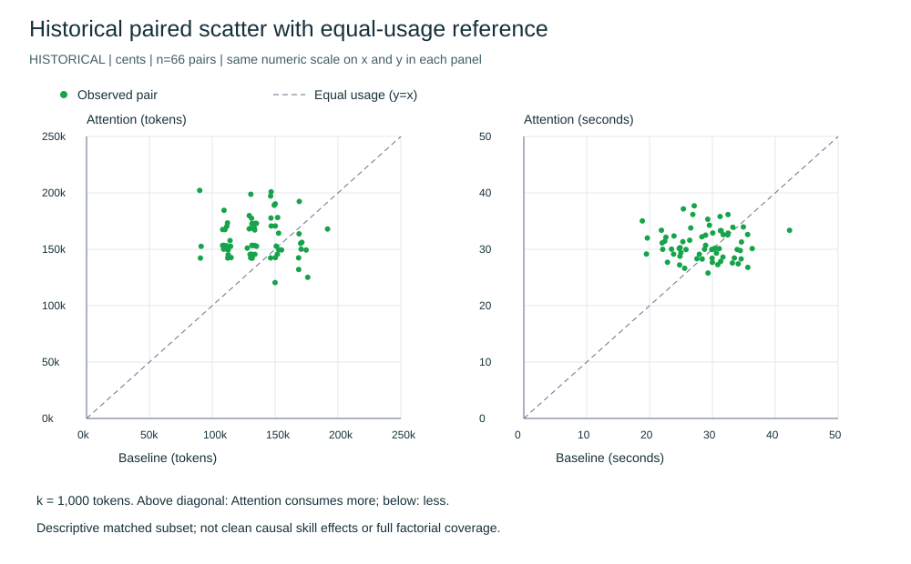
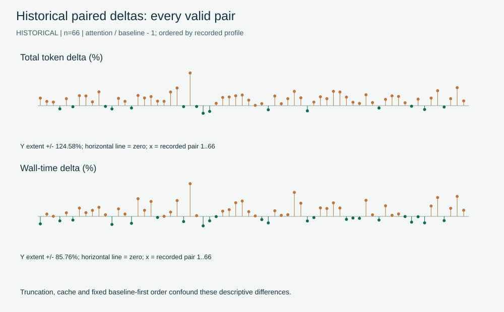
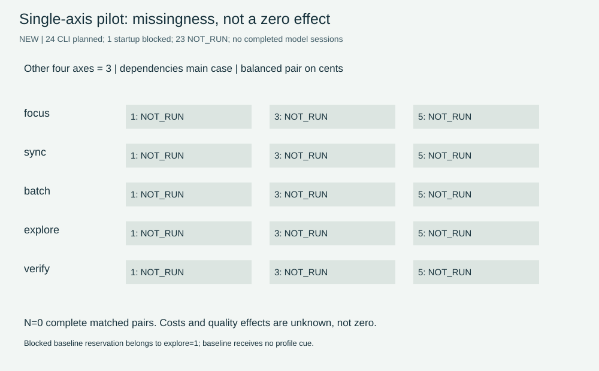
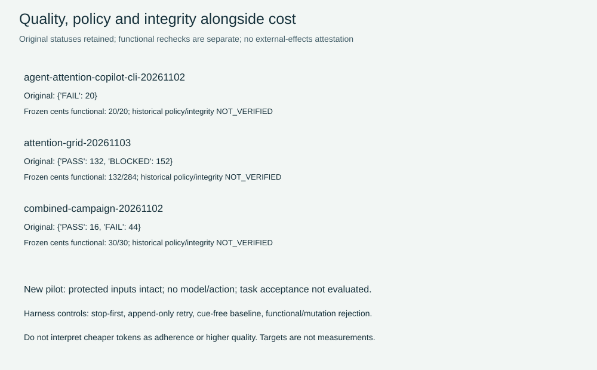

# Copilot measurement integrity and single-axis pilot

2026-11-03. Agent Attention 0.2.6; profile semantics remain 0.1.1.
Historical data and new attempts are separate. The research PDF is a secondary
source; its hypothetical improvement targets are not observations.

## Outcome

- Reproduced all 364 historical package records: 20 standalone, 60 combined,
  284 partial-grid. These correspond to 35, 90 and 284 CLI invocations.
- Fresh frozen source-only cents checks accept 20/20 standalone outputs and
  30/30 combined outputs. Their original exact-reference FAILs remain unchanged.
- The grid remains 132 PASS, 152 BLOCKED, 688 absent/NOT_RUN out of 972 planned
  cells. Only 66 matched pairs complete; every successful attention profile has
  focus=1 and case=cents. This is not a five-axis factorial result.
- Added a replacement bounded paired harness with stop-first shared marker,
  append-only reservations/results, neutral baseline prompts, isolated homes,
  pinned source inputs and protected skill payloads. It does not resume the old grid.
- New pilot: one CLI startup BLOCKED before model execution, zero model sessions,
  23 NOT_RUN. A relative-path harness bug caused startup failure, was repaired
  and regression-tested. The shared marker remains in place; no retry was made.

## Sources, pins and portable reproduction

[Historical observations](historical.json) contain normalized per-package CLI
usage, wall time, original statuses, original checks/protected/reference fields,
separate frozen-functional outcomes, discovery source categories, tool-start
counts, reported models and SHA-256 pins for raw logs, usage and source datasets.
All historical reported models found in saved usage are gpt-5.6-luna. Recorded
usage is CLI accounting, not an independently audited bill.

[Frozen pilot protocol](protocol.json), [new attempt and pending cells](pilot.json),
[computed summary](summary.json), [figure primitives](chart-data.json) and
[publication hashes](sha256.json) are the portable inputs/results. The protocol
was written before the CLI invocation. Its source pins identify the measured
pre-fix harness, not the corrected publication snapshot. The hash index separately
identifies current scripts; no unexecuted source is presented as measured.

Recompute metrics and SVG from only this repository:

```text
python -m scripts.evaluation.integrity_report --directory docs/testing/reports/2026-11-03
python -m unittest tests.test_campaign_control tests.test_integrity_report -v
```

Add `--png` on Windows with PowerShell 7/System.Drawing to render the same scene
primitives to PNG. SVG/summary need only Python 3.11+. PNG raster bytes can vary
with platform font/rendering versions; the source primitives and SVG are pinned.
The diagrams retain the repository's green/cream palette. No PDF source or raw
private log is published. Importing a new local snapshot is a separate read-only
operation using `python -m scripts.evaluation.copilot_audit --source-root <private>
--output <new-directory>`; it executes frozen cents checks in disposable copies,
never checks or model code inside the original raw workspace.

## Historical acceptance audit

| Campaign | Packages / CLI | Original status | Fresh cents functional | Interpretation |
|---|---:|---|---|---|
| Attention standalone | 20 / 35 | 0 PASS, 20 FAIL | 20/20 PASS | Exact-source false negatives; all four arms 5/5 functionally |
| Combined | 60 / 90 | 16 PASS, 44 FAIL | 30/30 PASS | All 30 cents FAILs are functional false negatives |
| Grid | 284 / 284 | 132 PASS, 152 BLOCKED | 132/132 completed PASS | 152 quota workspaces fail task checks; this is not model accuracy |

Combining the retained 16 revision PASSs with the 30 fresh cents PASSs reproduces
the historical mixed regrade 46/60: exhaustive 10, attention 9, idea 8, workflow 7,
combined 7, manual 5 out of ten each. This is a mixed historical summary, not a new
semantic validation of the revision task. Revision sorted_ids ambiguity is not
resolved by a code oracle; those records remain HISTORICAL_NOT_REVALIDATED here.

The frozen cents oracle accepts equivalent local variable names/whitespace.
Existing negative controls reject wrong results, early SystemExit(0), forged PASS,
oracle-side protected mutation, extra source, aliases and cached-bytecode
shadowing. The new runner pins all case/skill files and checks scope before a
fresh source-only oracle run. This is fixture acceptance, not an OS security
sandbox for arbitrary adversarial Python or proof of absent external effects.

Historical `.agents` scope exemptions did not certify skill-payload integrity.
Traces also show personal Copilot skills loaded. Standalone and combined control
arms received the treatment payload/activation cues. The grid removed the main
activation prefix but added a negative Agent Attention/profile cue and still
loaded personal skills. Historical policy and complete host isolation are
NOT_VERIFIED; these studies cannot establish a clean causal skill effect.



## Grid stop/resume repair

The original grid source declares stop-on-quota but has no break after the
BLOCKED result; its done-key set includes blocked rows. It continued for 151
additional quota launches. Resuming skips the old blocked keys rather than
representing a reviewed retry. The raw harness was hashed/read, never modified
or restarted. No 688-cell resume or 152-cell retry was attempted.

The first quota record has 5 tool starts and 35,261 total tokens, premium=1.
It must not be described as pre-action BLOCKED: preserve original BLOCKED and
annotate partial work separately. The other 151 quota records have no tool start
and recorded zero token usage. Zero is the CLI's value, not an unknown-value
imputation. A zero-usage quota record still incurred wall time.

The replacement control module distinguishes partial FAIL from pre-action
BLOCKED_ENVIRONMENT while stopping either. It checks the shared marker before
each call and creates it exclusively on the first stop condition. It reserves
attempts before invocation and appends results. A reserved call without a result
is UNKNOWN/interrupted, not NOT_RUN and never an automatic retry. Explicit linked
retries require new authorization and stop-state review. No code clears a marker.
One process runs at most one CLI at a time. Calls, packages, internal model
requests and tool starts remain different units.

## Paired historical costs

Only the 66 pairs with both original PASS and fresh cents functional PASS are
included. Cache read/write and reasoning are subsets and are not added again.
Total tokens are input + output; premium requests/nanoAIU are not USD or credits.

| Descriptive statistic | Token delta | Wall-time delta |
|---|---:|---:|
| Mean of per-pair percentages | +21.9379% | +10.6656% |
| Ratio of group means | +18.3568% | +7.5667% |

Attention uses fewer tokens in 15/66 pairs; baseline uses fewer in 51/66.
The PDF abstract reports +7.54% time while its table reports +7.57%. Raw wall
durations give +7.5666518853%, which rounds to the table value. Neither discrepancy
is resolved by choosing a more favorable figure. Pair order is fixed and the
grid truncates systematically; no confidence interval, axis ranking or general
token/time savings estimate is justified. These are repeated observations,
not a learning curve. No hypothetical target is drawn as measured data.





## New frozen single-axis design and startup failure

Seed 20261103 shuffles 11 profiles on dependencies: balanced plus each single
axis at 1 and 5 with other axes at 3. A balanced pair on cents brings the plan to
24 CLI invocations, at most 180 seconds each. Pair order alternates baseline-first
and attention-first. Both focus extremes are explicitly present in the plan.
Both arms use the same task/constraints/oracle; baseline workspace contains no
candidate payload and its prompt has no skill name, profile or activation cue.
Per-attempt home/workspace/history is new. No credential was copied, no model or
reasoning setting was overridden. Actual model must be reported from usage.

Prerequisite deterministic controls passed before freezing. The first baseline
launch failed in CLI argument processing: `cwd` and `-C` both contained the same
relative workspace, so Copilot resolved a duplicated path and returned ENOENT.
There were no events, tool starts or model/usage records. The original result
retains BLOCKED_ENVIRONMENT with stop_reason USAGE_UNAVAILABLE; this audit adds
the more specific diagnosis HARNESS_RELATIVE_CWD. It is not evidence of quota,
authentication failure or model capacity. Missing usage remains null.

The shared marker was written immediately and retained. The defect was repaired
by resolving output before constructing cwd, home, usage and -C arguments. A
fake-CLI integration regression verifies real existing absolute paths, an auth
stop, one invocation, and 23 pending cells. An interrupted-reservation control
also failed before its repair and passes afterward. These tests are deterministic
fixtures, not additional model calls. The corrected harness was not re-run
against a model; automatic continuation would violate the stop contract.

The first metadata cell is explore=1, but baseline receives no profile; this is
a pairing label only. Zero complete pairs means every per-axis effect is unknown.
No completed model/session restoration or conditional behavior is claimed for
this campaign. Existing exhaustive helper restoration and earlier model-map
observations retain their own pins and are not relabeled as fresh pilot evidence.





## Verification and remaining work

Full suite: 118 tests, 115 PASS and three platform symlink skips; generated assets,
live links and diff checks PASS after the report was created. An intermediate
suite correctly failed on three links to the not-yet-written report; those are
resolved. Default sandbox temp permissions required an unrestricted local test
run; PNG rendering uses PowerShell 7 because Windows PowerShell script policy
blocked the first render. No machine policy or dependencies were changed.

Tests independently cover stop-after-partial-quota, capacity, no auto retry,
append-only linkage, interrupted reservations, missing/malformed usage, baseline
cues, both focus extremes, source-only oracle negatives, changed aggregate input,
zero-sample summaries, duplicate/missing cells and exact chart-data regeneration.
The generic skill picker is NOT_RUN, as are new per-axis model effects, clean
runtime discovery and real-session restoration. Auth with an isolated home has
not been tested because startup failed first. No tokens or successes are invented
for the remaining cells. Concurrent chat timing would be a confound if both
pilots reached models; no cross-repository speed comparison is made.

Remote CI must be checked against the published commit, not old successful runs.
Only validate.yml is versioned here; a CodeQL result requires its own exact-SHA
check-run evidence. Publication status is recorded in the task status and final
delivery; a pending check is never promoted to PASS.

The useful next step requires a human-reviewed release of the shared stop state
and a newly frozen bounded pilot. It is not an automatic retry. Until then,
balanced defaults and targeted risk-based overrides remain guidance, not proven
optimal token settings. This package completes the authorized offline audit and
repair while leaving the blocked experiment explicitly unfinished.
