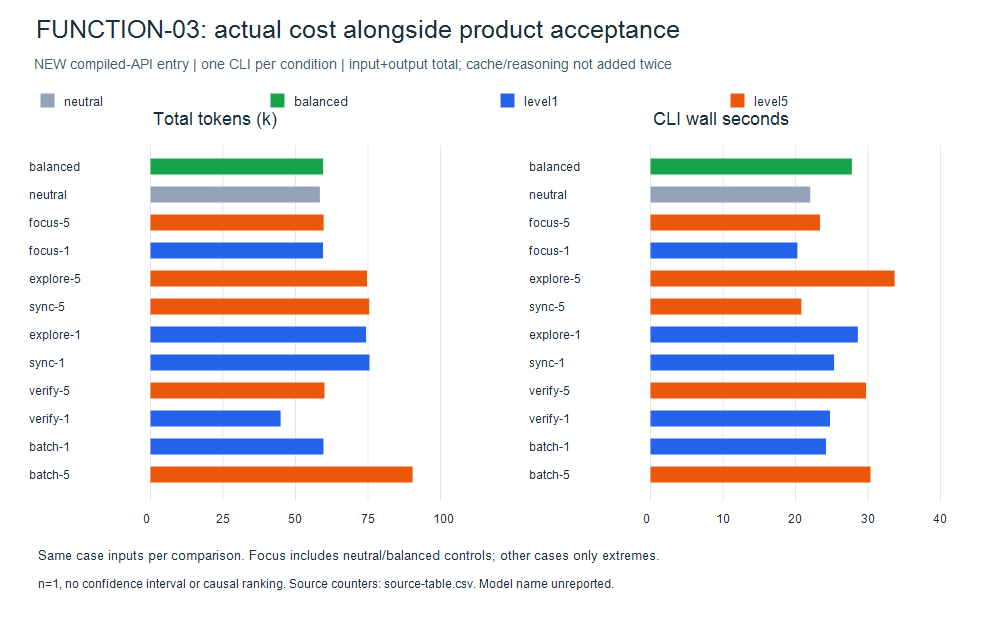
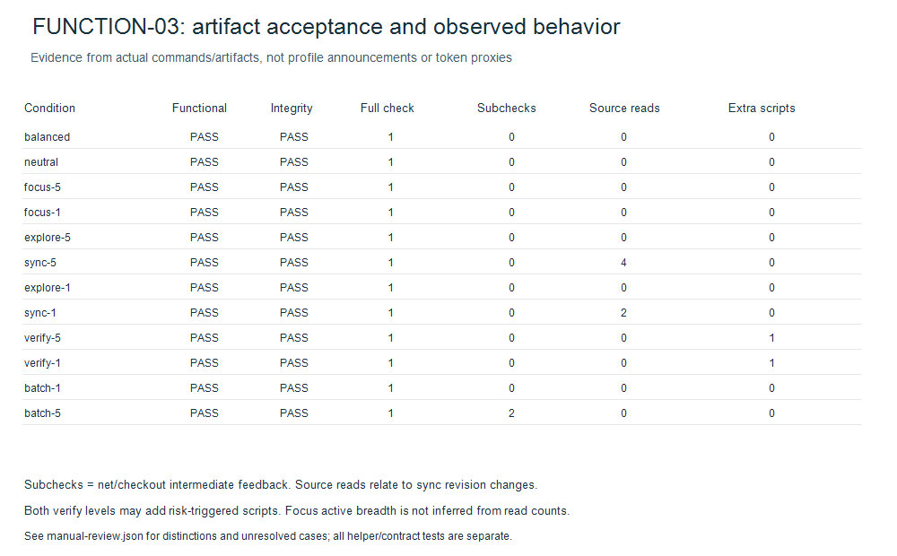

# FUNCTION-03 — published scoped-product evaluation (PARTIAL)

Twelve new Codex CLI attempts completed: functional 12/12, file integrity 12/12,
full mandatory checks 12/12. Budget exhausted (12 reserved, zero active/remaining).
Actual model name NOT_REPORTED in all twelve; configured CLI defaults retained.
No retries, quota/auth failures or timeout attempts occurred in this campaign.
Older COORD-02 and historical observations remain separate and are not pooled.

## Product changes and before/after

| Area | Before | Current |
|---|---|---|
| Compact handoff | CLI prompt format absent (exit 2) | Selected directives plus invariants (exit 0) |
| Skill entry | 7,380 bytes, eager reference content | 3,317 bytes, five lazy axis references |
| Scoped state | No scope API | Base recomputation and restoration on exit/return/exception/finish |
| Combined packet | No explicit contract API | Strict full five-axis v1 packet, boolean True opt-in, rejects routes/authority |
| Validation | Full/partial checks ambiguous in metadata | Actual full checks separately audited; original observations retained |

Byte reductions are not token-saving measurements. Original 25 level strings,
balanced defaults and legacy JSON remain compatible. Setup select can emit compact
resolved guidance without a graph. Workflow still owns WHAT/NEXT/STOP. Attention
only controls HOW and never waives mandatory or risk-triggered checks.

## Actual token and time costs



Figure 1. Total tokens (thousands, input + output) and CLI wall seconds for 12
completed attempts, n=1 per condition. Gray=neutral, green=balanced, blue=level1,
orange=level5. Focus includes neutral/balanced controls; the other cases compare
only their two extremes. Different cases must not be pooled as an axis ranking.
Cache/reasoning subcounts are not added twice. This is descriptive cost, not
causal savings or evidence that every higher level is better.
[Download SVG](actual-costs.svg) · [Source CSV](source-table.csv) ·
[Observations JSON](observations.json) · [Figure primitives](chart-data.json) ·
[Reproduction script](../../../../../scripts/function03_report.py).

## Observed effects and limits



Figure 2. Each row is one completed CLI attempt; all 12 pass functional/integrity
and full mandatory checks. Subchecks, source reads and extra scripts are counts
of observed commands, not quality scores or active-context measurements. Two
batch subchecks and 4 versus 2 sync source reads support single-case cadence
observations. Focus and verify contrasts remain unproven; 12/12 functional PASS
does not certify five-axis adherence. [Download SVG](acceptance-behavior.svg) ·
[Source JSON](observations.json) · [Manual interpretation](manual-review.json).


Batch level 5 introduced two intermediate feedback checks versus zero at level 1.
Sync level 5 read changing source four times versus two; both correctly used the
new revision and blocked stale approval. Explore level 5 read one extra legacy
source, without demonstrated quality benefit. Focus breadth did not separate.
Both verify levels performed independent checks; no quality contrast was found.
See manual-review.json for artifact/trace evidence and qualification.

Each condition has one model invocation. Levels 2/4 have compiler tests only.
These observations do not establish reliability, causality, a ranking of levels,
or general/monotonic token savings. Costs use input + output; cached/reasoning
subcounts are not added twice. Raw per-session counters are in source-table.csv;
missing values remain unknown, never zero-imputed. Charts were rendered and viewed.

Prefer balanced for routine work, targeted batch feedback for dependent edits and
sync reconciliation for source churn. Raise verify for risk while retaining checks
at low levels. Do not set everything high mechanically or use levels as a native
model effort/token budget. More focus/verify identification and replication would
be needed; no additional model calls are authorized in this exhausted task.

## Provenance and verification

protocol.json freezes order and measured source hashes; sanitized measured source archives, command evidence and budget receipt are published here. Private raw traces remain unavailable in the public packet. observations.json retains measured
fields and adds a separately named trace_audit. All attention sessions use caller-
compiled API handoff, not native picker discovery. Host context inventory passed
(candidate one skill, neutral zero, no parent instructions); this is not full OS
or runtime prompt attestation. Native picker/direct skill model entry, live combined
integration and real-model scope restoration are NOT_RUN.

Post-pilot CLI diagnostic, full-check metadata and strict opt-in corrections are
unit-tested but not re-measured with models. Measured snapshots are preserved;
current source hashes are separate. The source delivery passed 153 local tests (150 PASS, three symlink skips),
assets and whitespace checks. Source commit 9c2d15a and checkpoint 4174d10 passed
all four CI configurations and both CodeQL jobs. This presentation correction
has separate final gates and exact-SHA CI recorded in the delivery checkpoint.
A first local gate encountered sandbox temp access denial; an escalated normal-temp
rerun passed. An incorrectly named single-test selector errored before execution;
module rerun reproduced the opt-in failure, then the repaired full suite passed.

The product and evidence are published. No release/tag, version bump, global
install or peer repo edit was made. See the [delivery checkpoint](../../../../../task/FUNCTION-03-RESULTS.json)
for exact commit/CI state; immutable experiment NO_PUSH flags below are historical.

## Published evidence and frozen source reproduction

Original observation/protocol bytes (including their then-current NO_PUSH flag)
are retained. That flag records the experiment stage; it does not describe current
delivery authorization. Current source receipts become STALE when code changes;
measured source archives retain original pins. Published command excerpts omit
agent messages, session/account IDs and machine paths; original raw-trace hashes
identify provenance but do not permit byte-for-byte raw trace replay. No raw trace
is publicly available. Command redactions are listed in trace-evidence.json.

See [source archives](snapshot-index.json), [trace evidence](trace-evidence.json),
[budget receipt](budget-receipt.json) and [publication hashes](sha256.json).
Source archives contain only frozen repository source, fixtures and skill files;
no credentials, private config, local maps or experiment workspaces. They let a
reviewer inspect measured implementations and run deterministic controls, not
repeat model outcomes. Reports/figures reproduce offline from observations:

```text
python -m scripts.function03_report --directory docs/testing/reports/2026-11-03/function-03
python -m scripts.evaluation.delivery --directory docs/testing/reports/2026-11-03/function-03
```

The final review corrected a remaining status gate: missing mandatory-command
evidence or a transport/accounting stop cannot earn PASS even if an artifact
passes its oracle. Synthetic negatives reproduce the old acceptance flaw; this
post-campaign fix does not relabel original observations. All measured attempts
had valid usage and successful mandatory commands. No new model calls followed.

Final delivery checks and current historical receipt invalidation are recorded in
[final gates](final-gates.json). Earlier gate counts remain historical snapshots.
