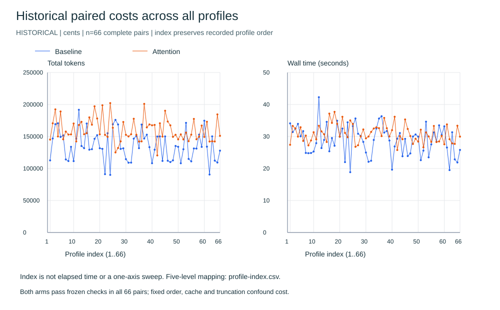
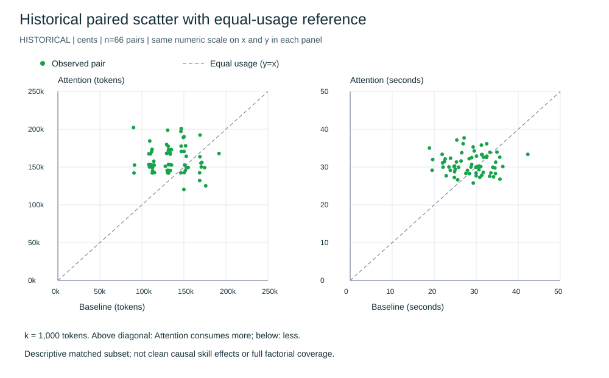
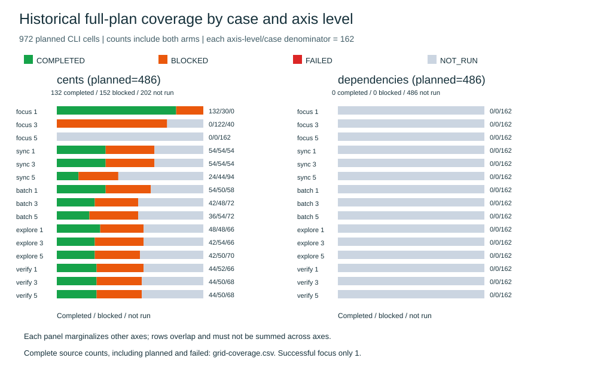

# Figure revision and authorized recovery

2026-11-03; Agent Attention remains 0.2.6. This update changes research
presentation and adds a separate attempt dataset; it does not change skill
semantics or justify a version bump.

## What is measured

The primary figures below show all **66 historical complete cents pairs** from
the partial Copilot grid. Both arms pass the frozen functional oracle in these
pairs. The original grid has 972 planned CLI cells: 132 original PASS, 152
original BLOCKED and 688 absent/NOT_RUN. Dependencies has no completed historical
cell. These descriptive figures are not a completed factorial or isolated-axis
causal experiment.

The [full historical audit](copilot-integrity.md) explains exact-reference false
negatives, baseline payload/cue leakage, personal-skill discovery contamination,
fixed execution order, quota continuation and resume defects. The data and old
status fields are preserved. No bad attempt was dropped to improve a chart.

## Token and time lines: all pairs, exact recorded order



Each panel contains 66 baseline points and 66 attention points connected in
recorded profile order. **The x index is not wall-clock time, a learning curve or
a sweep of one attention axis.** Five levels change together in this historical
prefix. Total tokens = input + output; cache and reasoning subsets are not added
again. Seconds are CLI wall time, not API time.

The complete [index-to-five-level table](profile-index.md) gives all 66 mappings
and token/time values. The [CSV source table](profile-index.csv) retains full
precision for re-analysis. Every valid pair is included, without smoothing,
sample selection or fabricated target lines.

## Scatter: numerical ticks, labels, units and equal-usage line



Both panels use the same numeric limits on x and y. The dashed y=x line means
equal usage; green points are observed pairs. The token panel labels thousands
with k; the time panel uses seconds. Above the line means attention consumes
more, below means less. White plotting areas, light grids and explicit legends
replace the earlier unlabeled scatter. The paired percentage deltas and their
source values remain in [summary.json](summary.json).

For this subset, attention has fewer tokens in 15/66 pairs. Mean pair token
change is +21.9379%; ratio of group means is +18.3568%. Mean pair wall-time
change is +10.6656%; ratio of group means is +7.5667%. These are different
statistics. The last value matches the secondary PDF's table rounded to +7.57%,
while its abstract says +7.54%. There is no observed quality separation on the
frozen checks; cost alone is not evidence of adherence or higher quality.

## Full coverage: both cases, all axes and levels



Each case has 486 planned cells. For each case/axis/level, the denominator is
162 CLI cells, including both arms and every combination of the other four
axes. Cents has 132 completed, 152 blocked and 202 not run; dependencies has
0 completed, 0 blocked and 486 not run. The [coverage table](grid-coverage.csv)
includes planned, completed, blocked, failed and absent counts for all 30 rows.
Marginal rows overlap; do not sum five different axes as independent samples.

BLOCKED retains the original label, including the first quota attempt with
5 tool starts. The audit explains why that attempt was partial work and why
the other 151 quota records must be distinguished. NOT_RUN is missingness,
not a zero-cost or zero-quality outcome. This coverage figure supplements
the actual cost series; a NOT_RUN card is no longer the main result figure.

## New campaign: preflight passed, actual authentication blocked

The user explicitly authorized a new bounded campaign after diagnosing the
earlier HARNESS_RELATIVE_CWD startup bug. That old attempt and marker remain
unchanged. A shared recovery decision named the new marker for both repository
chats; no old grid or old blocked cell was resumed.

Preflight executed the installed CLI's --version and --help with absolute cwd
and -C paths, an existing workspace and a separate home. Both exited 0. The
new [frozen protocol](recovery-protocol.json) retains the 24-call design: 11
profiles on dependencies (balanced and each axis alone at 1/5, others 3), plus
a balanced baseline/attention pair on cents. Order alternates arms, seed is
20261103. No model/effort override, credential copying or global edit was made.

One real new CLI was then invoked. Absolute path handling succeeded. The CLI
reported **“No authentication information found.”** in its isolated home and
exited before any model event or tool action. The recorded usage cannot be
parsed as complete accounting. The harness stored MALFORMED_USAGE and created
the new stop marker; the separate audit diagnosis is **AUTH_FAILURE**. Both
layers are retained rather than overwriting the original record.

| Campaign | CLI invoked | Completed model sessions | Tool starts | NOT_RUN | Diagnosis |
|---|---:|---:|---:|---:|---|
| Original pilot | 1 | 0 | 0 | 23 | HARNESS_RELATIVE_CWD |
| New recovery pilot | 1 | 0 | 0 | 23 | AUTH_FAILURE after absolute-path preflight |

See [new observations](recovery-pilot.json) and the sanitized
[recovery decision/preflight receipt](recovery-decision.json). Unknown token
usage stays null; these failures are not quality scores. The second marker
remains active. No calls were made after the authentication/accounting failure.

Consequently there is still **no measured new per-axis effect, quality change
or behavioral comparison**. Plotting these as new results would fabricate data.
The real prerequisite is authentication compatible with the isolated campaign;
it was not solved by reusing the user's home or exposing a token. A further
campaign requires the user to resolve that prerequisite and review the stop
state; there is no automatic fallback to a contaminated baseline.

## Reproduction and verification

```text
python -m scripts.evaluation.integrity_report --directory docs/testing/reports/2026-11-03 --png
python -m scripts.evaluation.publication --directory docs/testing/reports/2026-11-03
python -m unittest discover -s tests -v
python scripts/attention_assets.py
```

SVG/CSV/scene JSON rebuild from public inputs using Python only. PNG rendering
uses PowerShell 7 and System.Drawing on Windows. Actual PNG outputs were viewed
after rendering to inspect ticks, labels, legends and line series. Regression
checks count 264 line-series points, enforce all 66 CSV rows, verify the 30
coverage denominators, preserve the old attempt and confirm the new auth stop.
The [hash index](sha256.json) covers published inputs, outputs and scripts.

The final test/CI counts for this update are recorded in
[task status](../../../../task/TASK-STATUS.md) and exact-SHA delivery checks.
Illustrations for the primary skills are unchanged. No per-axis extrapolation,
general Codex average, causal saving or completed grid is claimed.
